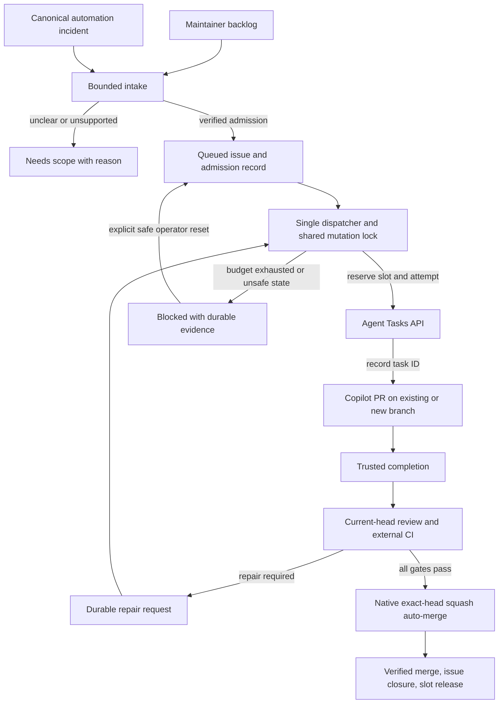

# Dark Factory Enterprise Architecture

The factory extends the repository's GH-AW issue-to-merge pipeline with
policy-controlled intake and bounded recovery. It is shipped in observation
mode. The code and historical examples in this guide are not evidence that a
new version has been activated on `main`; live enablement and delivery proof are
separate operations. See [operations](dark-factory.md) for commands.

## Control flow

## Components and ownership

| Component            | Source                                               | Responsibility                                                                     |
| -------------------- | ---------------------------------------------------- | ---------------------------------------------------------------------------------- |
| Intake               | `.github/workflows/dark-factory-intake.md`           | Admission and needs-scope records; no task creation                                |
| Dispatcher           | `.github/workflows/dark-factory-dispatch.md`         | Execution state, slot reservation, task creation, adoption, retries, and closure   |
| Completion           | `.github/workflows/complete-copilot-prs.yml`         | Latest-task completion proof and draft readiness; explicit operator reset          |
| Label backstop       | `.github/workflows/label-copilot-prs.yml`            | Same completion gate, restricted to the triggering PR                              |
| PR controller        | `.github/workflows/pr-merge-assistant.md`            | Review requests, durable repair requests, and merge assurance                      |
| Secondary PR path    | `.github/workflows/draft-pr-automerge.md`            | Same assurance for the triggering PR; no label-only bypass                         |
| Incident reporter    | `.github/workflows/automation-incident-reporter.yml` | Canonical signatures, repeat suppression, event reporting, scheduled backstop      |
| Shared runtime       | `.github/scripts/dark-factory/src/`                  | Typed policy, GitHub adapter, schemas, state, repository evidence, and transitions |
| Runtime build action | `.github/actions/factory-runtime/action.yml`         | Frozen-lockfile dependency setup and build                                         |
| Transition action    | `.github/actions/factory-transition/action.yml`      | Safe-output validation and native exact-head merge handoff                         |
| External assurance   | `.github/workflows/dark-factory-tests.yml`           | Tests, strict types, lint, build, and workflow compilation                         |

GH-AW Markdown is source; its lockfile is generated by compiler v0.89.21.
Intake/dispatch/merge reconcile on schedules and relevant events. Completion has
a separate scheduled backstop. All state-changing factory workflows use the
**same** `dark-factory-mutation` concurrency group with in-progress cancellation
disabled. The compiler does not support concurrency on custom safe-output jobs,
so serialization is at workflow scope, including deterministic prefetch.

GitHub may coalesce pending runs; schedules eventually reconcile missed events.
No factory workflow recursively dispatches a follow-up. GitHub-token-authored
label changes are not assumed to trigger downstream workflows.

The dispatcher is the only agent-start/retry writer. The merge controller records
repair requests instead of toggling assignees or launching a competing worker.
Squad routing and human-only assignments remain outside its ownership.

## Admission policy

Automatic admission requires current repository maintainer permission or
verified incident provenance. Explicit enrollment from a maintainer remains
available for external reports. Scope is checked structurally against concrete
acceptance criteria or bug reproduction/expected behavior; incomplete templates,
epics, and research do not become implementation tasks automatically.

Dependencies combine native blocking relationships with explicit issue-body
sections. Parent references are not prerequisites. All dependencies are examined
for cycles and missing/unsupported references, even if another prerequisite is
already open. Unchanged scoping decisions are not repeatedly posted.

Existing PRs and tasks are reconciled before new work is started. Non-factory
PRs, ambiguous task/branch artifacts, and duplicate ownership prevent a second
claim. A matched historical Copilot PR can be adopted without a date cutoff;
the same provenance and completion gates still apply.

## Durable state and capacity

State is stored in versioned, schema-validated comments owned by the immutable
GitHub Actions bot identity. The source repository/issue IDs and content
fingerprint bind records to the issue. Each record has one writer:

- Admission: source, origin, decision, reason, and run.
- Execution: phase, revision, slot reservation, PR/task IDs, attempt intents,
  correlation keys, retry history, and next eligible recovery.
- Completion: task ID, PR ID, and observed head.
- Review: PR ID, head SHA, request time, and run.

Malformed or duplicate records do not become empty/default state. Issues are
enumerated across open and closed state so a manual closure or label removal
cannot hide an outstanding reservation. Artifacts and caches are diagnostic
evidence, not the authoritative attempt counter.

Three distinct source issues can be in flight. Build, review, CI waiting, and
repair consume the same slot; an issue's task and PR are not counted separately.
Unknown outcomes retain reservations. Unrelated user/desktop tasks are never
silently adopted or cancelled.

Task creation has no documented server-side idempotency key. Before the POST,
the dispatcher persists a unique intent. After acceptance, it records the exact
task ID. If the response is lost or that write fails, later reconciliation
matches the marker in verified task-session data. Zero or multiple matches
remain ambiguous; there is no blind resubmission.

## Recovery semantics

The first task is followed by at most five recovery attempts. New repair tasks,
infrastructure reruns, and repeated lost-review requests share that counter.
Ordinary first reviews and read-only observations do not. Backoff survives runs.
An authorized reset archives the old attempt history rather than erasing it.

Completed task evidence cannot mark a PR ready while a newer task owns the same
branch. Completion records also prevent a scheduled ready check from clearing a
new repair request merely because an older task is still `completed`.

Repairs target the verified existing head branch through the Agent Tasks API.
No code path separately assigns Copilot after creating a task. Cancelled tasks
and manually closed unmerged PRs are not silently recreated. Idle or
waiting-for-user tasks expose their blocker instead of receiving fabricated
answers. A running task is not duplicated simply because progress looks stale.

Credential rejections open a controller launch circuit, preserving other
issues' budgets. Exhausted item recovery marks that item blocked. Explicit
resets require current maintainer permission and terminal, unambiguous work;
they cannot cancel a running task or bypass an emergency stop.

## Incident provenance and recovery evidence

The reporter preserves its canonical normalized failure signature and
repeat-comment throttle. It monitors intake, dispatch, readiness, labeling,
review/merge, and the existing review workflow. A scheduled backstop inspects
recent unreported failures, including reporter failures, without a self-trigger
loop.

An incident marker is not authority. The runtime verifies bot identity,
repository, allowlisted workflow path, trusted event, run attempt, failed job,
failed step, and matching live failure annotations. Attempt numbers preserve
the original failure even when a subsequent rerun succeeds.

Transient infrastructure failures can use bounded reruns only on the current
trusted revision. Code failures can enter the repair pipeline; credential and
unsupported setup failures need explicit operator action. Later recovery must
show the same job and step completing successfully. A skipped step or unrelated
successful no-op does not establish recovery. Recovery searches use a bounded
recent-success sample; absence of proof is not proof of success.

## Assurance and trust boundaries

1. Privileged jobs check out **`main`**, never PR-controlled code, and do not
   persist checkout credentials. Dependencies use the frozen lockfile with
   install scripts disabled. Credentials are provided only to the steps that
   need them.
2. GH-AW receives a deterministic selected decision. Safe outputs can request
   only that keyed transition. The privileged job re-reads state and refuses a
   changed decision.
3. The task API requires a supported user token with Agent tasks read/write.
   Repository/task IDs, PR artifacts, branch artifacts, and current task/session
   state establish ownership. Unknown enum values fail closed.
4. PR authors must be Copilot bot ID `198982749`, login `Copilot`, type `Bot`.
   The head is a same-repository `copilot/*` branch, and the base is `main`.
5. Copilot reviewer ID `175728472` must have reviewed the exact current head.
   Timestamps do not substitute for commit identity. Requested changes and
   unresolved threads block merge.
6. All external check runs must complete acceptably and all status contexts
   must succeed; at least one is required. Controller checks are excluded by
   known workflow name **and** path. Factory regression tests remain external.
7. The primary and secondary paths use the same assurance checks. They disable
   pending factory auto-merge when stop state or current assurance is invalid.
   `factory:human-review` is a manual stop, not a changed-path risk lane.
8. The trusted transition action performs native squash auto-merge with
   `--match-head-commit`. This checks the head when requesting merge; GitHub
   rules remain the server-side boundary for subsequent PR changes. No bypass
   flags or ruleset changes are introduced.

The read-only CLI denies REST mutations and GraphQL mutations before transport.
Write credentials are explicit; the read role cannot submit writes. Public PR
tests have no task-write or merge secrets.

### Compiler and credential changes

The updated workflows expose the existing task token to deterministic task
reads and the dispatch safe-output job. The secondary merge path now uses the
same existing automation token and gates as the primary path. Runtime setup
uses pinned official Node, checkout, pnpm, and GH-AW action revisions; the
compiler action pin is recorded in `.github/aw/actions-lock.json`. These tokens
are not passed to issue-authored commands or PR checkouts. Account eligibility
and deployed token permissions still require operator verification.

## Operational evidence and limits

A run summary states why work is idle, waiting, scoped out, capacity-limited,
recovering, or degraded. A `merge-authorized` result is not a merged PR.
Actual merge evidence and source-issue closure release the slot.

Mode snapshots and labels do not instantly revoke an already-running task or a
pending native auto-merge request. The manual `/landfest` command remains a
separate maintainer command, not a factory recovery mechanism. Production
deployment and rollback are outside this change's delivery boundary.

## Historical proof

The earlier opt-in factory completed issue
[#465](https://github.com/VeVarunSharma/contoso-vibe-engineering/issues/465)
through PR
[#466](https://github.com/VeVarunSharma/contoso-vibe-engineering/pull/466).
[PR Merge Assistant run 35952589222](https://github.com/VeVarunSharma/contoso-vibe-engineering/actions/runs/35952589222)
enabled the merge, which produced commit
`eb814af25e42448ec5352160e73d4499f3011ecd` and closed the issue.

That historical documentation-only delivery is not a live proof of this
intake/recovery implementation. After authorized installation and activation,
record a fresh source issue, task ID, PR, review/check evidence, merge SHA, and
closure before declaring the new loop operational.
