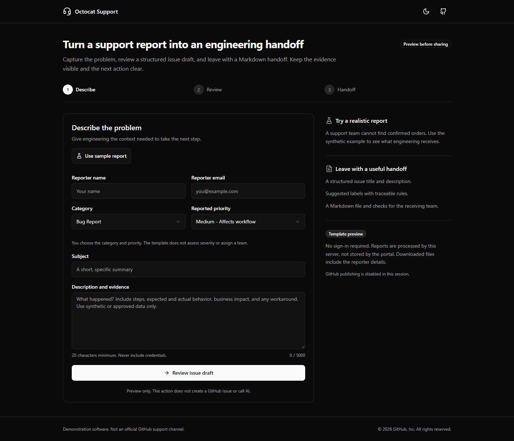
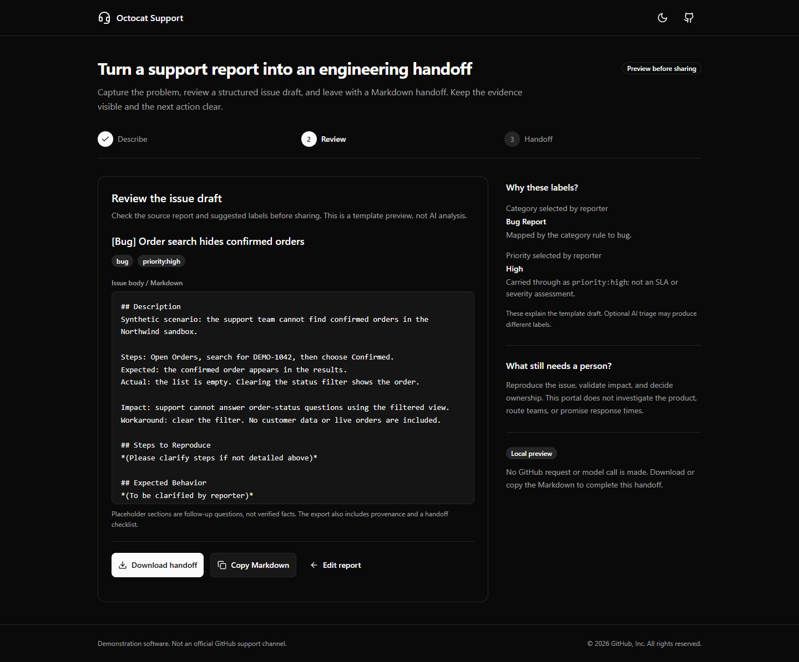
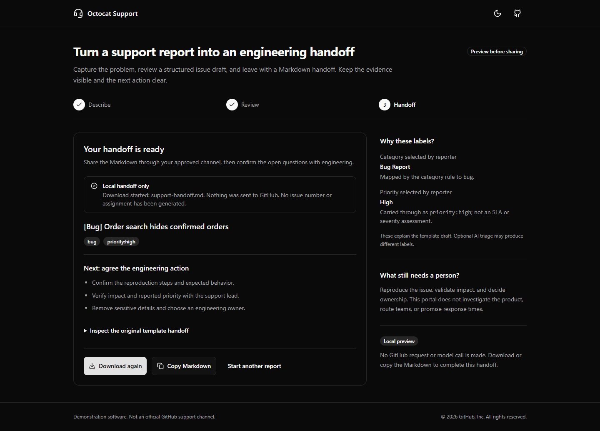

# Support report to engineering handoff

## Customer opener

> Support often has the customer story; engineering needs a reproducible problem, impact, and an owner. This demo turns that story into a reviewable handoff without hiding what is still unknown. We will use a fictional order-search report, inspect the label rules, and leave with a Markdown file that a person can review.

The primary user is a support analyst. The receiving user is an engineering triage lead. The useful outcome is a structured handoff, not a generic AI answer or a claim that the bug has been investigated.

## Five-minute demo

Start with the [local quick start](../README.md#getting-started). Keep `SUPPORT_MODE=preview`; no credentials or customer systems are needed.

| Minute | Action                                                                                              | Observable checkpoint / talk track                                                                                                                       |
| ------ | --------------------------------------------------------------------------------------------------- | -------------------------------------------------------------------------------------------------------------------------------------------------------- |
| 0-1    | Open the portal; select **Use sample report**.                                                      | The report contains synthetic reproduction steps, expected/actual behavior, impact, and a workaround. There are no real orders.                          |
| 1-2    | Select **Review issue draft**.                                                                      | The draft title is `[Bug] Order search hides confirmed orders`. `bug` and `priority:high` come from selected fields, not model inference.                |
| 2-3    | Inspect **Why these labels?** and the issue body. Use **Edit report** if needed, then review again. | Distinguish supplied evidence from template placeholders. No owner, SLA, or severity assessment is invented.                                             |
| 3-4    | Select **Download handoff** and open `support-handoff.md`.                                          | The file contains the report, labels, explicit preview provenance, and three review checks. The screen says **Local handoff only**, not "issue created." |
| 4-5    | Select **Start another report**; discuss one missing fact and its owner.                            | The form resets predictably. The next action is a human review, not an automatic production change.                                                      |



_Start: the purpose, sample action, and output are visible without setup instructions in the application._



_Decision: inspect what was supplied, what the rules did, and what still needs verification._



_Result: a downloadable handoff and a clear next action. [Mobile/light-mode view](images/support-mobile.png)._

## Recovery

| Situation                       | Recovery                                                                                                                            |
| ------------------------------- | ----------------------------------------------------------------------------------------------------------------------------------- |
| Invalid or empty fields         | Follow the focused field and inline message. Input is retained.                                                                     |
| Preview service disconnected    | Restore the local server/connection and select **Review issue draft** again. There is no silent fallback.                           |
| Clipboard denied                | Use **Download handoff**. If downloads are blocked, change the browser's download permission yourself.                              |
| Port already occupied           | Use the quick start's `next dev --hostname 127.0.0.1 --port 3102` command with an unused port. Never stop another session's server. |
| Live publishing unavailable     | Continue with the explicitly local export, or have the administrator correct the named configuration.                               |
| Live response lost or AI failed | Check the configured repository before any retry; an issue might already exist. No automatic retry or template fallback occurs.     |

The portal stores no report history. Reloading loses the current form; download before leaving. Reset never deletes files or GitHub issues.

## Adapt it

| Reuse unchanged                                                                  | Customize for the customer                                                                                                                                                                                                                       |
| -------------------------------------------------------------------------------- | ------------------------------------------------------------------------------------------------------------------------------------------------------------------------------------------------------------------------------------------------ |
| Intake/review/export flow, Zod validation, and shared `@workspace/ui` components | Branding/copy in the [page](../apps/octocat-support-app/app/page.tsx), [header](../apps/octocat-support-app/components/site-header.tsx), and [footer](../apps/octocat-support-app/components/site-footer.tsx), preserving applicable attribution |
| Template builder shared by preview and direct publishing                         | Approved example data in [`sample-ticket.ts`](../apps/octocat-support-app/lib/sample-ticket.ts); field/category/priority definitions in [`types.ts`](../apps/octocat-support-app/lib/types.ts)                                                   |
| Explicit consent and preview-mode publishing block                               | Repository, repository-scoped identity, and visibility in [local configuration](../apps/octocat-support-app/.env.local.example)                                                                                                                  |
| Transparent provenance and human review checks                                   | Category-to-label rules and body templates in [`ticket-draft.ts`](../apps/octocat-support-app/lib/ticket-draft.ts); update tests and optional [`prompts.ts`](../apps/octocat-support-app/lib/prompts.ts) together                                |

Local rehearsal has no metered integration calls. Live GitHub requires a suitable repository-scoped token and existing labels. Live AI also needs authenticated Copilot CLI/model access and can incur account-specific usage. It can rewrite the template draft; inspect the resulting issue. No cloud deployment is included.

Before using real reports, agree who may receive reporter data, retention, repository visibility, and private security-report handling. Authentication, rate limiting, and cross-request deduplication are implementer work before external use, not features claimed by this demo.

## Discovery and a bounded pilot

Ask the support lead, engineering reviewer, and repository/security owner:

1. Which missing facts most often cause a report to be returned to support?
2. Who decides priority and ownership, and what evidence do they require?
3. Which reporter details may leave the support system, and which cases must stay private?

**Proposed next action:** run a 90-minute workshop with five to ten synthetic or approved, de-identified reports. A support analyst supplies the cases, an engineer defines a ready-for-review checklist, the SE facilitates, and the security/repository owner approves any optional integration. Keep the exercise local unless separately authorized.

Collect a baseline by preparing the same kinds of handoffs manually first. Record elapsed time from opening each report to reviewer acceptance, missing checklist items, and clarification requests. These are **proposed targets, not achieved customer results**:

| Measure                  | Proposed target / collection method                                                                                                                    |
| ------------------------ | ------------------------------------------------------------------------------------------------------------------------------------------------------ |
| Evidence completeness    | Every exported handoff retains supplied steps, impact, reporter context, and explicit open questions; reviewer checks the Markdown against the source. |
| Time to accepted handoff | Explore a 25% median reduction versus the manual baseline across paired cases; record rejected drafts and rework, not just generation time.            |
| Independent reuse        | A second SE reaches a valid handoff within 10 minutes after prerequisites are installed, using only the guide; record cache state and help needed.     |

Decide whether to extend the accelerator only after this review. No customer outcome or independent SE validation is implied by automated tests.

## Reproduce and validate

From the repository root, the [application README](../apps/octocat-support-app/README.md#validate) lists the Jest, lint, typecheck, and build commands. For browser checks on Windows with **already installed Microsoft Edge**:

```powershell
$env:PLAYWRIGHT_CHANNEL = "msedge"
$env:SUPPORT_DEMO_PORT = "3102" # Choose an unused port.
pnpm --filter octocat-support-app test:demo
```

The runner starts its own loopback server in preview mode and does not reuse another server. It exercises desktop/dark and mobile/light views, checks real downloads byte-for-byte, rejects live publishing, checks error contrast, and tests retained input/retry. Only the failure-path test intercepts a request; the screenshots use the unmocked happy path. GitHub and SDK boundaries are tested with mocks, not unauthorized live writes.

To refresh the four screenshots above with synthetic data:

```powershell
$env:UPDATE_DEMO_SCREENSHOTS = "1"
pnpm --filter octocat-support-app test:demo
Remove-Item Env:UPDATE_DEMO_SCREENSHOTS
```

If Edge is unavailable, install Playwright's Chromium into this checkout's ignored dependency directory, not a shared browser location:

```powershell
Remove-Item Env:PLAYWRIGHT_CHANNEL -ErrorAction SilentlyContinue
$env:PLAYWRIGHT_BROWSERS_PATH = "$PWD\node_modules\.cache\playwright"
pnpm --filter octocat-support-app exec playwright install chromium
pnpm --filter octocat-support-app test:demo
```

In POSIX shells, set the same environment variables with `export`. Inspect regenerated images for clipping and legibility before sharing. Screenshots are stored in `docs/images/support-*.png`; transient traces and failure captures stay in the app's ignored `test-results` directory.

For a handoff timing check, start a stopwatch before the filtered dependency install and stop when the first sample handoff is downloaded. Record Node/pnpm versions, whether packages were cached, and whether a person needed assistance. A same-machine cached rehearsal is **not** a fresh-machine or independent-SE validation.

### Recorded local check: 2026-10-21

Windows, Node.js 24.11.1, pnpm 10.26.2, installed Microsoft Edge. Commands ran from the repository root; browser checks used `PLAYWRIGHT_CHANNEL=msedge` and the unused port `50554`.

| Command                                                                                                                                                                 | Result                                                                                         |
| ----------------------------------------------------------------------------------------------------------------------------------------------------------------------- | ---------------------------------------------------------------------------------------------- |
| `pnpm --filter octocat-support-app test:ci`                                                                                                                             | Passed: 67 tests in 9 suites (23 tests passed before the changes).                             |
| `pnpm --filter octocat-support-app lint`                                                                                                                                | Passed: no ESLint rule warnings/errors.                                                        |
| `pnpm --filter octocat-support-app typecheck`                                                                                                                           | Passed.                                                                                        |
| `pnpm --filter octocat-support-app build`                                                                                                                               | Passed.                                                                                        |
| `pnpm --filter octocat-support-app test:demo`                                                                                                                           | Passed: 6 desktop/mobile checks, including real downloads and error recovery.                  |
| `pnpm install --frozen-lockfile --filter octocat-support-app...` followed by `pnpm --filter octocat-support-app test:demo --project=desktop --grep "real downloadable"` | Passed: cached restore took 146.0 seconds; the complete timed run took 348.8 seconds (5m 49s). |

The timing includes dependency restore, runner/server startup, one automated sample download, and cleanup. Prerequisites and cloning were excluded; this was the same worktree with an existing package cache, **not** independent SE validation. No live GitHub issue or model call was made. Other applications/services were not revalidated. Existing `next lint` deprecation and ESLint configuration module-format notices remain.
